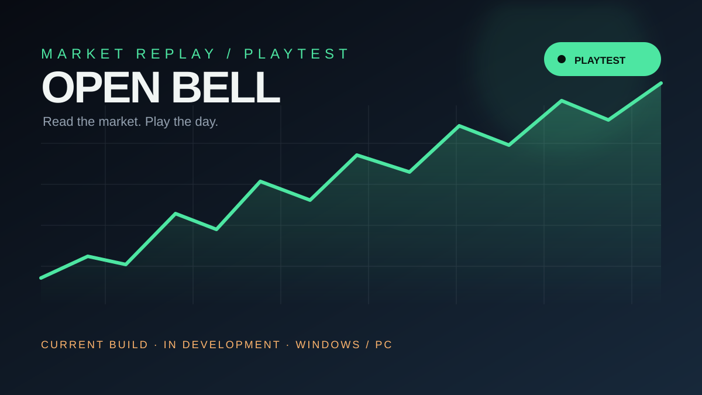

# Open Bell Playtest

## 目前可玩試玩版

這是 Open Bell 的 Windows / PC 開發中試玩版。可以體驗交易、行情回放、生涯模式與人生劇本（1987／2000／2008／2020）、智能復盤與原創配樂，但內容、平衡與介面仍會持續調整，**不是最終版本**。

**[下載 OpenBell-Playtest.zip](https://openbell.me/OpenBell-Playtest.zip)**（約 41 MB）

## 創作者聲明

Open Bell 由 **Tirde Studio** 創作。Open Bell 名稱、品牌視覺與本專案內容，其版權及相關權利歸 Tirde Studio 所有；未經授權不得擅自重製、重新發布或商業使用。

Copyright © 2026 Tirde Studio · Open Bell™

- 平台：Windows 64-bit
- 狀態：開發中試玩版
- 行動版：測試階段，尚未作為正式下載
- 製作地：Taiwan (Republic of China)

下載後解壓縮，雙擊資料夾內的 `OpenBell.exe` 即可啟動（`OpenBell.pck`、`trading_sim.dll` 需放在同一資料夾）。若 Windows 顯示 SmartScreen 提示，請確認檔案來源是 `openbell.me`。
